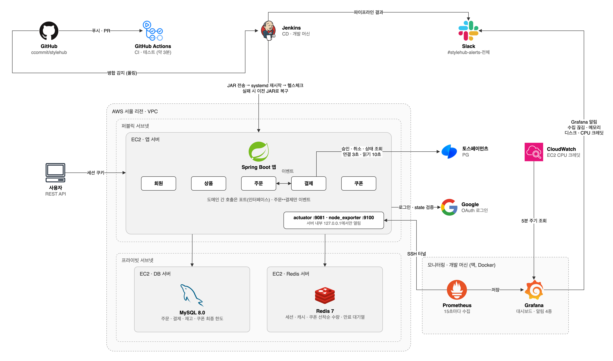
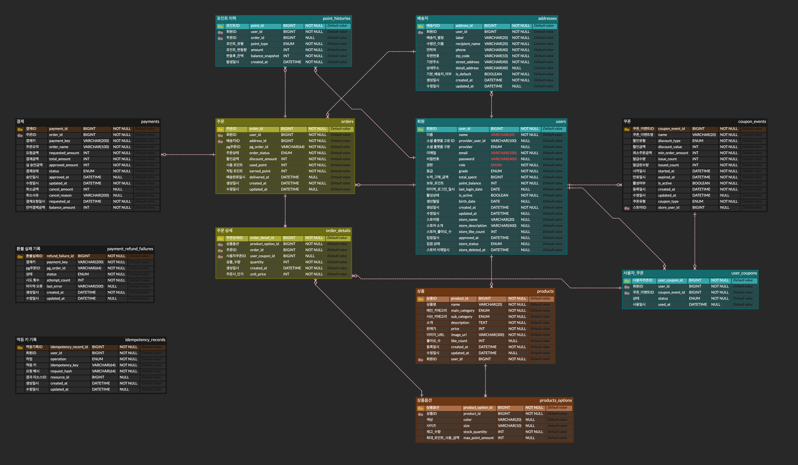
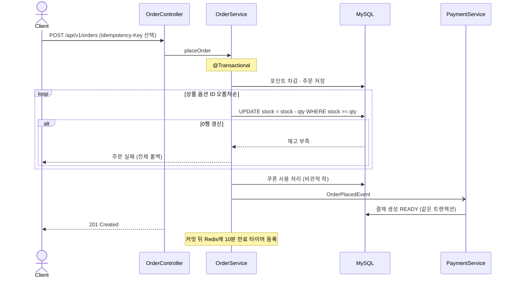
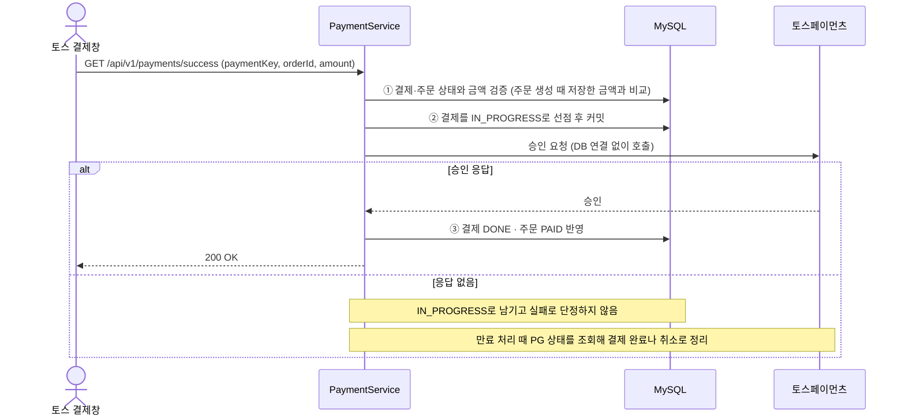
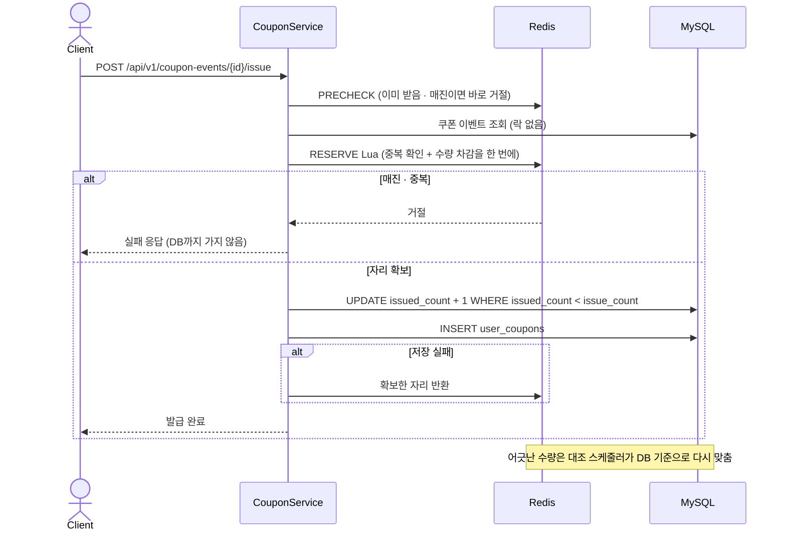

 # [Stylehub](https://bwj1207.tistory.com/category/stylehub%20%ED%94%84%EB%A1%9C%EC%A0%9D%ED%8A%B8) 
---

---
### 무신사 같은 패션 커머스 플랫폼  **StyleHub**

> 💡 **Guide:** 
> 본 README의 모든 **파란색 키워드**는 프로젝트관련 위키 혹은 개발 블로그로 연결됩니다.  
> `Ctrl + 마우스 좌클릭`을 활용해 새 탭에서 상세 내용을 확인하며 읽으시는 것을 추천합니다 

---

## 📌 목차
1. [프로젝트 소개](#1-프로젝트-소개)
2. [주요 기술 과제](#2-주요-기술-과제)
3. [트러블슈팅](#3-트러블슈팅)
4. [주요 아티클](#4-주요-아티클)
5. [아키텍처](#5-아키텍처)
6. [기술 스택](#6-기술-스택)
7. [ERD](#7-erd)
8. [시퀀스 다이어그램](#8-시퀀스-다이어그램)
9. [API 문서](#9-api-문서)
10. [주요 기능](#10-주요-기능)
11. [개발 철학](#11-개발-철학)
12. [협업 방식](#12-협업-방식)

---

## [1. 프로젝트 소개](https://github.com/ccommit/stylehub/wiki/%EA%B8%B0%ED%9A%8D%EC%84%9C)

“**1,000명이 동시에 몰려도 쿠폰은 정해진 수량만, 한 사람에 한 장씩.**”

 선착순 쿠폰 발급, 재고 차감, PG 결제처럼 요청이 겹치는 곳의 정합성을 다룬 패션 커머스 백엔드 프로젝트입니다.
 
> 요청이 몰리거나 외부 결제 응답이 끊기는 상황을 테스트로 재현했고, 고친 뒤에는 같은 조건으로 다시 측정해 확인했습니다.
> 테스트와 배포는 GitHub Actions와 Jenkins로 자동화했습니다.
 
* 🎯 **주제 선정 이유** : [프로젝트 배경 및 계기 확인](https://bwj1207.tistory.com/116) `Ctrl + 마우스 좌클릭` 
* 📝 **상세 기능 명세** : [기획서 바로가기](https://github.com/ccommit/stylehub/wiki/%EA%B8%B0%ED%9A%8D%EC%84%9C) `Ctrl + 마우스 좌클릭` 

---

## 2. 주요 기술 과제

### 선착순 쿠폰 발급
- **고민**: 열리는 순간 요청이 몰려도 정해진 수량만 한 사람에 한 장씩 나가야 했습니다. 쿠폰 행에 비관적 락만 걸었더니 받지 못할 요청까지 줄을 서서 매진 응답이 2.65초 걸렸습니다.
- **해결**: Redis Lua 스크립트로 중복 확인과 수량 차감을 한 번에 처리해 받지 못할 요청을 먼저 돌려보냈습니다. 최종 기준은 DB로 두고 발급 수가 한도보다 적을 때만 1을 올렸습니다.
- **결과**: 1,000명 동시 요청에서 매진 응답 2.65초 → 0.46초 · [근거](https://github.com/ccommit/stylehub/wiki/%EA%B7%BC%EA%B1%B0-%EC%84%A0%EC%B0%A9%EC%88%9C-%EC%BF%A0%ED%8F%B0-%EB%B0%9C%EA%B8%89)

### PG 결제 승인 정합성
- **고민**: PG 응답이 끊기면 승인 여부를 알 수 없습니다. 실패로 처리해 주문을 취소하면 승인된 결제의 돈만 빠져나간 채 남습니다.
- **해결**: 승인을 "진행 중 저장 → PG 호출 → 결과 반영" 세 단계로 나눴습니다. 응답이 없으면 실패로 단정하지 않고 PG에 다시 확인해 정리합니다. 금액은 주문 생성 때 저장한 값과 비교합니다.
- **결과**: PG 응답 2초 지연 때 주문 목록 조회 1.4초 → 28ms, 같은 결제에 승인 10번 동시 요청에도 PG는 한 번만 호출 · [근거](https://github.com/ccommit/stylehub/wiki/%EA%B7%BC%EA%B1%B0-%EA%B2%B0%EC%A0%9C-%EC%8A%B9%EC%9D%B8-3%EB%8B%A8%EA%B3%84)

### 상품 목록 조회 성능
- **고민**: 상품 100만 건에 1,000명이 조회하자 P95가 510ms였습니다. 스토어 이름 하나를 위해 판매자 엔티티를 통째로 읽어 32개 컬럼을 가져오고 있었습니다.
- **해결**: 화면에 필요한 8개 컬럼만 DTO로 조회하고 첫 페이지와 상세는 Redis에 60초 캐시했습니다. 캐시 확인은 트랜잭션 밖으로 옮겼습니다.
- **결과**: P95 510ms → 43ms (캐시 적중률 99.5%) · [근거](https://github.com/ccommit/stylehub/wiki/%EA%B7%BC%EA%B1%B0-%EC%84%B1%EB%8A%A5-%ED%85%8C%EC%8A%A4%ED%8A%B8) · [시나리오 설계 글](https://bwj1207.tistory.com/140) · [커서 페이징 글](https://bwj1207.tistory.com/130)

### 주문·결제 도메인 분리
- **고민**: 주문 서비스가 결제 저장소까지 직접 참조해서 결제를 고치면 주문도 고쳐야 했고, 포트로 바꾸자 두 서비스가 서로를 주입받는 순환 참조가 생겼습니다.
- **해결**: 주문은 "주문이 생겼다"는 이벤트만 알리고 결제 생성은 결제 쪽이 맡게 했습니다. DB를 바꾸는 리스너는 같은 트랜잭션에서 실행해 결제 기록 없는 주문이 남지 않게 했습니다.
- **결과**: 순환 참조 제거 · [근거](https://github.com/ccommit/stylehub/wiki/%EA%B7%BC%EA%B1%B0-%EB%8F%84%EB%A9%94%EC%9D%B8-%EA%B2%BD%EA%B3%84)

### 배포 자동화와 실패 시 자동 복구
- **고민**: JAR를 그대로 덮어쓰면 새 버전이 뜨지 못할 때 서비스가 내려간 채 남았습니다.
- **해결**: 테스트는 GitHub Actions, 배포는 Jenkins로 나누고, 교체 전 JAR를 보관해 60초 안에 헬스체크가 통과하지 않으면 되돌리게 했습니다.
- **결과**: 실제 배포 실패에서 자동으로 이전 버전 복구 (아래 트러블슈팅 빌드 #34) · [근거](https://github.com/ccommit/stylehub/wiki/%EA%B7%BC%EA%B1%B0-%EB%B0%B0%ED%8F%AC-%EC%9A%B4%EC%98%81)

---

## 3. 트러블슈팅

### 주문 취소 중 다른 주문의 재고 차감이 사라짐
- **문제**: 재고 8에서 2개짜리 주문을 취소하는 사이 다른 주문이 1개를 사면 9가 되어야 하는데 10이 저장될 수 있었습니다.
- **원인**: 취소 쪽이 재고를 읽고 더해서 저장했는데, JPA가 한 트랜잭션 안에서 먼저 읽은 객체를 다시 써서 잠금을 걸고 다시 읽어도 처음 값 8을 돌려줬습니다.
- **해결**: 복구도 차감처럼 `stock = stock + :qty` UPDATE 한 문장으로 바꿔 DB가 현재 값에 더하게 했습니다.
- **검증**: 같은 순서를 재현한 테스트에서 고치기 전 10, 고친 뒤 9 · [근거](https://github.com/ccommit/stylehub/wiki/%EA%B7%BC%EA%B1%B0-%EC%9E%AC%EA%B3%A0-%EB%8F%99%EC%8B%9C%EC%84%B1)

### 일반 로그인에서만 포인트 적립이 빠짐
- **문제**: 하루 첫 로그인 포인트가 일반 로그인에서만 반영되지 않았습니다. 에러도 로그도 없었고 구글 로그인은 정상이었습니다.
- **원인**: @Transactional 적립 메서드를 같은 클래스 안에서 바로 불러 프록시를 건너뛰었습니다(self-invocation). 트랜잭션이 열리지 않아 UPDATE가 나가지 않았습니다.
- **해결**: TransactionTemplate으로 적립 블록이 트랜잭션이 되게 했고, "오늘 아직 안 받았으면 더한다"는 조건을 UPDATE 한 문장에 넣었습니다.
- **검증**: 실제 DB로 로그인한 뒤 DB를 다시 읽어 확인하고, 같은 날 로그인 10건이 동시에 와도 1회만 적립 · [블로그 글](https://bwj1207.tistory.com/127) · [근거](https://github.com/ccommit/stylehub/wiki/%EA%B7%BC%EA%B1%B0-%EB%A1%9C%EA%B7%B8%EC%9D%B8-%ED%8F%AC%EC%9D%B8%ED%8A%B8-OSIV)

### 로그인 없이 남의 결제를 취소할 수 있었음
- **문제**: 결제 취소 API가 로그인도 본인 확인도 없이 열려 있었고, 실패 콜백을 직접 부르면 승인된 결제도 실패로 바뀌었습니다.
- **원인**: 결제 콜백을 열려고 공개 경로를 /payments/** 묶음으로 넓혀 같은 경로의 취소까지 열렸습니다. 기능 테스트는 정상 사용자 경로만 봐서 통과했습니다.
- **해결**: 공개 경로를 콜백 두 개로 좁히고 소유권은 결제 서비스가 PG 호출 전에 확인하게 했습니다. 실패 콜백은 승인 전 결제만 실패로 바꿉니다.
- **검증**: 등록된 모든 API의 접근 정책을 검사하는 테스트를 만들었고, 공개 경로를 다시 넓히자 이 테스트가 바로 실패 · [근거](https://github.com/ccommit/stylehub/wiki/%EA%B7%BC%EA%B1%B0-%EC%9D%B8%EA%B0%80-%EC%A0%90%EA%B2%80)

### 주문 부하 테스트의 500 에러
- **문제**: 주문 API에 100명 부하를 걸자 500 에러가 났습니다.
- **원인**: 잠금 경쟁이 가장 심한 인기 상품 요청은 한 건도 실패하지 않아 테스트 데이터를 의심했습니다. 실패 1,482건이 모두 무작위 상품 요청에서 났고, 실패율 66.8%가 판매자 없는 상품의 비율 67.0%와 거의 같았습니다.
- **해결**: 지금 스키마에서는 외래 키가 막는 데이터라 부하 스크립트가 판매자 있는 상품만 고르게 고쳤습니다.
- **검증**: 같은 조건에서 실패 0건 · [근거](https://github.com/ccommit/stylehub/wiki/%EA%B7%BC%EA%B1%B0-%EC%84%B1%EB%8A%A5-%ED%85%8C%EC%8A%A4%ED%8A%B8)

### 배포 실패 — 빌드 #34
- **문제**: 주문 멱등 키 기능을 배포하자 새 버전이 기동에 실패했습니다.
- **원인**: 새 테이블이 생겼는데 운영은 앱이 스키마를 만들지 않는 설정(`ddl-auto=validate`)이었습니다.
- **해결**: 헬스체크 실패로 이전 JAR로 자동 롤백됐고, 이후 배포 스크립트가 JAR 교체 전에 안전한 DDL 목록을 먼저 적용하게 했습니다.
- **검증**: Jenkins 빌드 #34에서 헬스체크 실패 후 이전 버전으로 복구 · [근거](https://github.com/ccommit/stylehub/wiki/%EA%B7%BC%EA%B1%B0-%EB%B0%B0%ED%8F%AC-%EC%9A%B4%EC%98%81)

### EC2 첫 배포 — OOM · MySQL 인증 · Swap
- 처음 EC2(t3.micro)에 올릴 때 메모리 부족과 MySQL 인증 문제를 겪은 과정입니다 · [블로그 글](https://bwj1207.tistory.com/152)

---

## 4. 주요 아티클

개발하며 직접 정리한 기술 블로그 글입니다.

**기획 · 설계**
- [프로젝트 주제 선정 이유](https://bwj1207.tistory.com/116)
- [커머스 DB 설계: ERD 설계하면서 가장 많이 고민했던 9가지](https://bwj1207.tistory.com/118)
- [4개의 파일로 시스템 전역의 예외 흐름 제어하기](https://bwj1207.tistory.com/151)

**기술적 의사결정**
- [Spring이라서 JPA를 선택하지 않았습니다 — JDBC, MyBatis, JPA 비교](https://bwj1207.tistory.com/121)
- [왜 QueryDSL을 도입했는가](https://bwj1207.tistory.com/122)
- [100만 건 상품 목록에서 Offset 대신 커서 페이징을 선택한 이유](https://bwj1207.tistory.com/130)
- [HTTP 세션 기반 인증 구현과 설계 의사결정](https://bwj1207.tistory.com/139)
- [성능 테스트 도구 비교 — Locust vs nGrinder vs Gatling vs JMeter](https://bwj1207.tistory.com/138)

**성능 · 트러블슈팅**
- [성능 테스트 시나리오 설계](https://bwj1207.tistory.com/140)
- [@Transactional 범위 최소화로 커넥션 점유 시간을 줄인 과정](https://bwj1207.tistory.com/126)
- [@Transactional이 동작하지 않는다? — Self-Invocation 버그 발견과 해결](https://bwj1207.tistory.com/127)
- [JPA 실전 경험 — 편리한 JPA가 장애가 되는 순간](https://bwj1207.tistory.com/137)
- [AWS EC2 배포 — OOM, MySQL 인증, Swap 트러블슈팅](https://bwj1207.tistory.com/152)

---

## 5. 아키텍처

- **애플리케이션**: 사용자 요청은 AWS EC2의 Spring Boot 앱으로 들어옵니다. 회원·상품·주문·결제·쿠폰 도메인이 한 앱 안에 있고, 도메인끼리는 포트(인터페이스)로 호출하며 주문과 결제 사이만 이벤트로 연결합니다.
- **MySQL 8.0**: 주문·결제·재고와 쿠폰의 최종 발급 한도를 책임집니다.
- **Redis 7**: 로그인 세션, 상품 목록·상세 캐시, 선착순 쿠폰 남은 수량과 발급자 목록, 미결제 주문 만료 대기열을 맡습니다.
- **외부 연동**: 결제는 토스페이먼츠, 소셜 로그인은 구글 OAuth를 사용합니다.
- **CI/CD**: 푸시·PR마다 GitHub Actions가 테스트를 돌리고, 배포는 Jenkins가 JAR를 교체한 뒤 헬스체크에 실패하면 이전 JAR로 되돌립니다.
- **모니터링**: Prometheus가 지표를 모으고 Grafana 알림과 배포 결과를 Slack으로 받습니다.

---

## 6. 기술 스택

 
| 분류 | 기술 스택 | 기술 선택 이유 |
|------|-----------|----------------|
| Language | Java 17| LTS 버전으로 안정성이 높고, 최신 기능 활용 가능 |
| Framework | Spring Boot 4.0.3 | 생태계 확장성 우수, 의존성 관리 최적화 |
| Database | MySQL (InnoDB) | 트랜잭션 ACID 보장, 인덱스 최적화로 안정적 데이터 처리 |
| ORM / Query | [Spring Data JPA](https://bwj1207.tistory.com/121) + [QueryDSL](https://bwj1207.tistory.com/122) | 객체 중심 설계, 타입 안정성 확보, 동적 쿼리 지원 |
| Cache · Session | [Redis](https://bwj1207.tistory.com/139) | 로그인 세션과 상품 캐시 저장, 선착순 쿠폰 수량을 Lua 스크립트로 한 번에 확인, 미결제 주문 만료 대기열 |
| Infrastructure | [AWS EC2](https://bwj1207.tistory.com/152) | 클라우드 기반 확장성, 안정적 파일 스토리지 제공 |

---

## 7. ERD

StyleHub는 패션 이커머스 서비스의 핵심 도메인인 사용자, 상품, 주문, 결제, 쿠폰을 중심으로 데이터 모델을 설계했습니다. 설계하며 고민한 내용은 [ERD 설계 글](https://bwj1207.tistory.com/118)에 정리했습니다.

주요 설계 기준은 다음과 같습니다.

- 도메인 중심 데이터 모델링을 통해 각 비즈니스 개념을 명확한 엔티티로 분리

- 주문, 결제, 쿠폰 사용 과정에서 데이터 정합성을 유지할 수 있도록 관계 설계

- 이커머스 서비스 특성을 고려하여 확장 가능한 구조로 모델링

### 주요 도메인 관계

- User → Order (1:N)
  하나의 사용자는 여러 개의 주문을 생성할 수 있습니다.

- Order → OrderDetail (1:N)
  하나의 주문에는 상품 옵션별 주문 상세가 여러 개 포함될 수 있습니다.

- Order → Payment (1:1)
  하나의 주문은 하나의 결제 정보를 가집니다.

- User → UserCoupon (1:N), CouponEvent → UserCoupon (1:N)
  사용자는 여러 쿠폰을 보유할 수 있고, 쿠폰 이벤트 하나로 여러 장의 쿠폰이 발급됩니다.

- User(스토어) → Product (1:N), Product → ProductOption (1:N)
  스토어 회원은 여러 상품을 판매하고, 재고는 상품 옵션(색상·사이즈) 단위로 관리합니다.

---

## 8. 시퀀스 다이어그램
### 주문 생성

### 결제 승인 (3단계)

### 선착순 쿠폰 발급

---

## 9. API 문서

- [API 명세 바로 보기](https://editor.swagger.io/?url=https://raw.githubusercontent.com/ccommit/stylehub/develop/docs/api/openapi.json) — API 35개, 각 API에 필요한 로그인·역할 표시
- 명세는 코드에서 만들고, 코드와 어긋나면 `OpenApiDocumentTest`가 실패해 문서가 낡지 않게 했습니다.

---

## 10. 주요 기능

- 일반 회웝가입과 구글 로그인을 할수 있다.
  
- 매장 관리자가 상품을 등록 수정 삭제할수 있다.
  
- 상품 카테고리는 2차 카테고리까지 있으며, admin이 등록한다.
- 상품을 등록하기 위해서는 매니저 회원가입 기능이 구현되어야 한다.
- 일반 사용자는  상품을 검색하고 상세정보를 확인할수 있다.
- 일반 사용자는 토스페이먼츠로 결제 할수 있다.
- 이용자가 쿠폰·포인트를 적용하여  할인을  받을 수 있다.
- 결제는 PG사(토스페이먼츠) 연동으로 처리하며 "금액 위변조 방지와 멱등성을 보장 및 결제이력관리"를 구현한다.
- 장바구니는 클라이언트에서 관리하며 "주문 시 상품 목록을 서버로 전달하는 방식"으로 구현한다
- 쿠폰은 Admin 플랫폼 전체 발행 | 매장 관리자(MANAGER)는  본인 매장별로 발행할 수 있다.
- 쿠폰의 종류는 정액/정율 타입이 있고 발행자는 발행 쿠폰을 취소 할 수 있다.

### 서비스 화면 프로토타입
**"구체적인 화면 설계를 통해 백엔드 로직의 완성도를 높였습니다."**

 👉[프론트 기획서 바로보기](https://ccommit.github.io/stylehub/)`Ctrl + 마우스 좌클릭`  
 
> 본 프로젝트는 백엔드 중심으로 진행되었으나, 실제 서비스의 흐름을 시각적으로 정의하기 위해 화면 프로토타입을 제작했습니다.  
> 머릿속으로 구상한 비즈니스 로직이 실제 화면에서 구현될 때 발생할 수 있는 논리적 모순을 사전에 방지하고자 했습니다.  
> 화면의 흐름을 따라가며 예외 상황을 미리 시뮬레이션했고, 이를 통해 요구사항에 최적화된 견고한 백엔드 아키텍처를 구축했습니다.

---

## 11. 개발 철학

### 1. 협업의 시작은 '문서화'로부터
> **"기억은 기록을 이길 수 없고, 기록은 삭제를 이길 수 없다. 하지만 기록된 지식은 팀의 문화를 만든다."**

* 1인 프로젝트였지만 언제든 동료가 합류할 수 있는 확장성을 염두에 두었습니다.
* 기술적 의사 결정,구현 로직, 시퀀스 다이어그램, 트러블슈팅 과정을 체계적으로 문서화하여, 별도의 온보딩 없이도 즉시 기여할 수 있는 고효율 개발 환경을 구축하였습니다.

---

### 2. 읽기 쉬운 코드가 최고의 협업 도구
> **" 컴퓨터가 이해할 수 있는 코드는 어느 바보나 다 짤 수 있다. 좋은 프로그래머는 사람이 이해할 수 있는 코드를 짠다. "**

* **동료를 위한 배려:** 코드는 쓰는 시간보다 읽히는 시간이 더 길기에 항상 '미래의 담당자'를 배려하며 개발하였습니다..
* **의도가 드러나는 설계:** 명확한 네이밍과 지속적인 리팩토링을 통해 별도의 설명 없이 코드 자체로 의도가 전달되는 'Self-describing Code'를 작성하려고 끊임없이 고민하였습니다.

---

### 3. '동작'을 넘어 '검증'에 집중한 완결성
> **"테스트는 버그가 없음을 증명하는 것이 아니라, 버그가 있음을 찾아내는 과정이다."**

  * **철저한 단위 테스트(Unit Test) 수행:** 로직의 가장 작은 단위부터 견고하게 구축하기 위해 핵심 비즈니스 로직에 대한 단위 테스트를 수행했습니다. 이는 코드 변경 시 발생할 수 있는 사이드 이펙트를 방지하고, 리팩토링의 심리적 안정감을 확보하는 기반이 되었습니다.
* **실패 케이스 중심의 검증:** 단순히 기능이 작동하는 '성공 케이스(Happy Path)'에만 만족하지 않았습니다. 의도적으로 잘못된 입력값이나 예외 상황(Edge Case)을 설정한 **실패 테스트를 병행**하여, 예외 상황에서도 데이터가 어긋나지 않는지 테스트로 확인했습니다.
* **추적 가능한 구조와 완결성:** 테스트를 통해 발견된 취약점을 즉각 보완하며 코드의 기술적 완결성을 높였습니다. 검증 가능한 구조를 유지함으로써 문제 발생 시 원인을 빠르게 파악할 수 있는 환경을 조성했습니다.

---

## 12. 협업 방식
- [1. 컨벤션(issue, pull request, code convention)](https://github.com/ccommit/stylehub/wiki/convention)  
- [2. 브렌치 관리 전략](https://github.com/ccommit/stylehub/wiki/%EB%B8%8C%EB%A0%8C%EC%B9%98-%EA%B4%80%EB%A6%AC-%EC%A0%84%EB%9E%B5)
